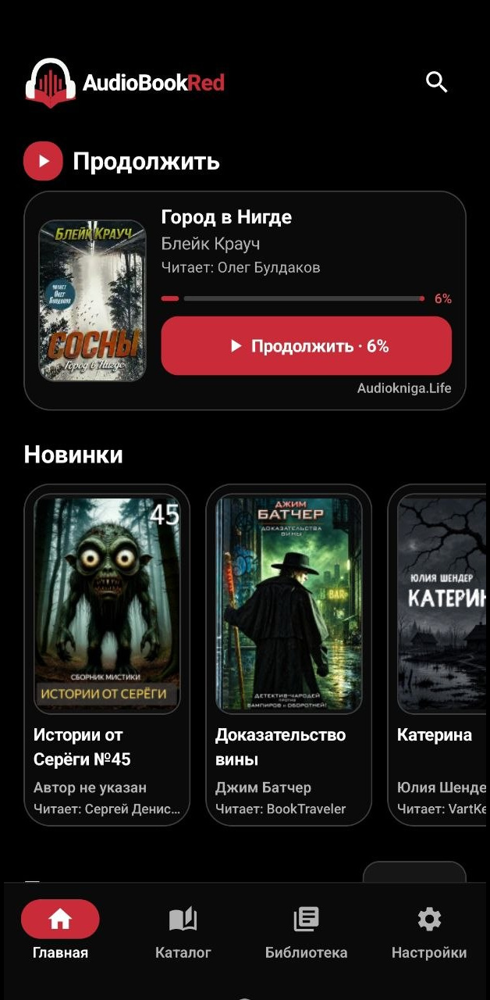
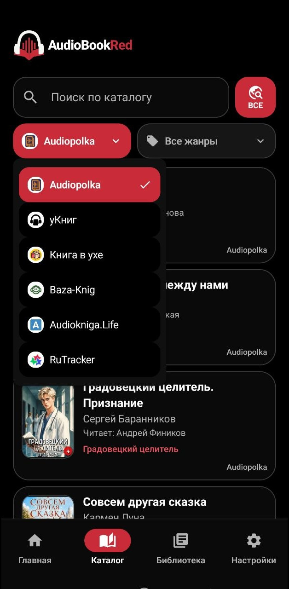
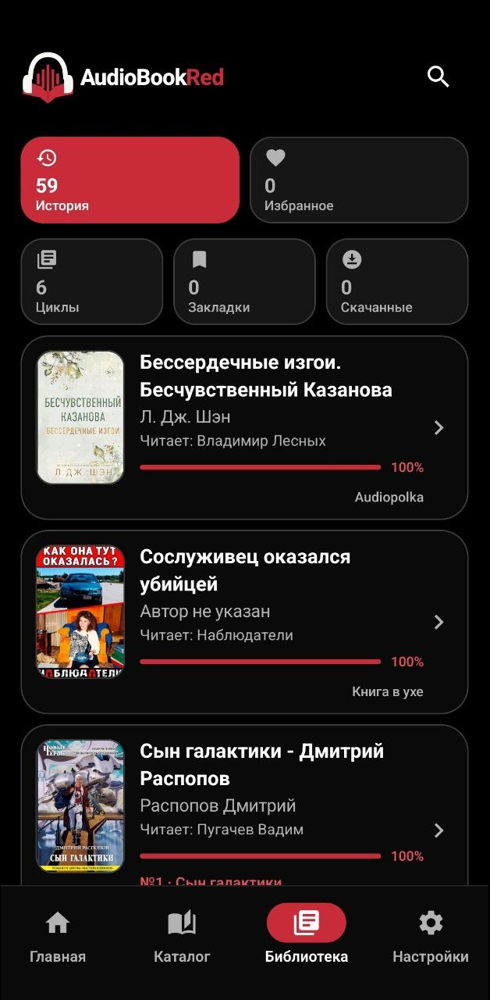
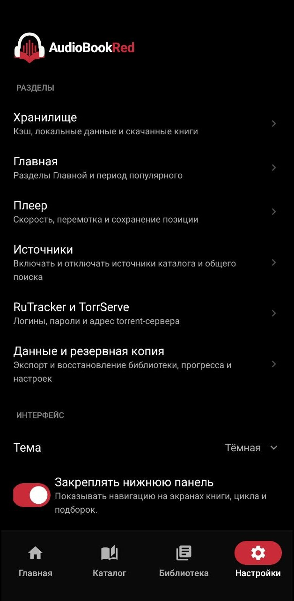

<div align="center">

# 🎧 AudioBookRed

**Android-приложение для чтения и прослушивания книг: аудиокаталоги, электронные книги и озвучка текста.**

Аудиокниги • Электронные книги • Читалка • RuVoice • Локальное скачивание


</div>

---

## Интерфейс

<p align="center">
  
  
  
</p>

<p align="center">
  
  
</p>

## Возможности

### Аудиокниги

- 🔎 поиск аудиокниг сразу по нескольким источникам;
- 📚 каталоги, жанры, авторы, чтецы и циклы;
- 🎛️ возможность отдельно включать и отключать источники для Каталога и общего поиска;
- 🏠 настраиваемая Главная: «Новинки», «Популярное», «Продолжить слушать» и «Скачанные»;
- ▶️ встроенный аудиоплеер с главами, скоростью воспроизведения и перемоткой;
- 🏷️ короткие названия глав «Глава 1», «Глава 2» и т. д. при желании;
- 🌙 таймер сна, пропуск тишины и закладки;
- ❤️ избранное, история, библиотека и сохранение прогресса;
- ⬇️ локальное скачивание аудиокниг;
- 💾 резервное копирование и восстановление пользовательских данных и настроек;
- 🚗 MediaSession и Android Auto;
- 🌓 светлая, тёмная и системная темы;
- 🧲 поддержка RuTracker и TorrServe.

### Электронные книги

- 📖 чтение TXT, FB2, FB2.ZIP, EPUB и ZIP с книгами;
- 🔎 каталог Fantasy Worlds: поиск, авторы, циклы и выбор формата при добавлении книги;
- 🎨 настройка шрифта, интервалов, полей и оформления текста;
- 🔊 озвучивание через отдельно устанавливаемый RuVoice;
- ⬇️ сохранение озвученной главы или всей книги в WAV для прослушивания без RuVoice;
- ✨ подсветка озвучиваемого фрагмента и переходы между чтением и прослушиванием;
- 🔖 отдельные позиции чтения и прослушивания, выделение и копирование текста;
- 📚 электронные книги в Библиотеке, истории, циклах и блоке «Продолжить».

**RuVoice** требуется для создания новой озвучки. Читать книги и слушать готовые WAV можно без него. Установка и выбор голоса доступны в разделе «Настройки → Чтение и озвучка».

## Источники аудиокниг

| **Источник** | **Каталог** | **Поиск** | **Прослушивание** |
| --- | :---: | :---: | :---: |
| Audiopolka | ✅ | ✅ | ✅ |
| уКниг | ✅ | ✅ | ✅ |
| Audioboo | ✅ | ✅ | ✅ |
| Книга в ухе | ✅ | ✅ | ✅ |
| Baza-Knig | ✅ | ✅ | ✅ |
| MY-AUDIOBOOKS | ✅ | ✅ | ✅ |
| Audiokniga.Life | ✅ | ✅ | ✅ |

Источники можно включать и отключать по отдельности в настройках приложения. Как минимум один источник всегда остаётся включённым.

> Доступность конкретного источника зависит от его текущей работы и структуры страниц. Для отдельных книг источник может предоставлять только ознакомительный фрагмент или метаданные.

### Электронные книги

**Fantasy Worlds** — каталог электронных книг с поиском, страницами авторов и циклов. Книги добавляются в библиотеку в одном из доступных форматов. Объединённый поиск по текстовым источникам и фильтр жанров пока не поддерживаются.

### RuTracker

RuTracker доступен как отдельный источник аудиокниг.

- для работы **поиска** необходимо указать в настройках приложения **логин и пароль RuTracker**;
- для **прослушивания и скачивания** через торрент требуется настроенный **TorrServe**;
- после полного скачивания аудиокнига может воспроизводиться локально без TorrServe.

## Для разработчиков

<details>
<summary><strong>Стек и сборка из исходников</strong></summary>

### Стек

- Kotlin;
- Jetpack Compose;
- AndroidX Media3 / ExoPlayer / MediaSession;
- Room;
- Paging 3;
- Hilt;
- WorkManager;
- OkHttp;
- Kotlin Coroutines;
- KSP.

### Требования

- JDK 17;
- Android SDK;
- Android platform `android-37.0`;
- Build Tools `37.0.0`.

### Проверка проекта

```bash
./gradlew --no-daemon testDebugUnitTest
./gradlew --no-daemon compileDebugAndroidTestKotlin
./gradlew --no-daemon lintDebug
```

### Сборка APK

```bash
./gradlew --no-daemon assembleDebug
```

</details>

## Лицензия

Проект распространяется на условиях **GNU Affero General Public License v3.0 (AGPL-3.0-only)**.

Полный текст лицензии находится в файле [LICENSE](LICENSE).

## Отказ от ответственности

Разработчики AudioBookRed **не размещают и не распространяют сторонние книги и медиаматериалы от имени проекта**. Приложение позволяет пользователю обращаться к сторонним ресурсам, а также импортировать и хранить выбранные им книги и аудиофайлы локально на своём устройстве.

Авторы проекта не контролируют содержимое сторонних источников и не несут ответственности за размещённые на них материалы, их доступность или правовой статус. Все права на контент принадлежат соответствующим правообладателям.

Пользователь самостоятельно несёт ответственность за соблюдение законодательства и правил сторонних сервисов при использовании приложения.
